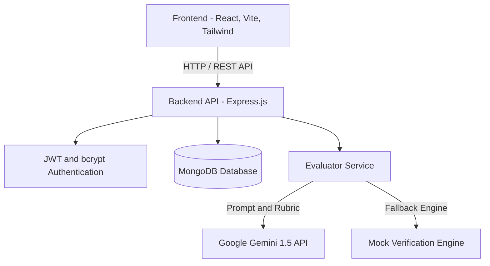

# ContextShift — AI-Powered Technical Interview Bug-Fix Simulator

> **"Debug Smarter. Think Deeper. Interview Better."**


---

## 🎬 Project Demo Video

> Click the link below to watch the full demo of DebugShift in action:

### 👉 [▶ Watch Demo Video on Google Drive](https://drive.google.com/file/d/1SsBqFZLvr7CVOmAnDrurjNejlbYQ06fC/view?usp=sharing)

[](https://drive.google.com/file/d/1SsBqFZLvr7CVOmAnDrurjNejlbYQ06fC/view?usp=sharing)

---

## 1. Project Overview & Problem Statement

### The Problem
Traditional coding interview platforms focus heavily on abstract algorithmic puzzles (e.g., reversing binary trees, dynamic programming matrix traversals). In real-world software engineering, however, developers spend over **70% of their time reading, debugging, and explaining fixes for broken codebases**.

### The Solution: ContextShift
**ContextShift** is an AI-powered technical interview simulator where software engineers practice real-world debugging. Instead of writing algorithms from scratch, candidates:
1. Receive intentionally broken **React.js** and **Express.js** production snippets.
2. Identify the runtime or architectural bug.
3. Submit corrected code and explain the root cause (*What is the bug? Why does it happen? How does the fix solve it?*).
4. Receive an instant, multi-dimensional **AI-generated evaluation report** powered by **Google Gemini** against a consistent senior engineering rubric.

---

## 2. Key Features

- **Developer Authentication**: Secure JWT-based authentication with `bcryptjs` password hashing, input validations, protected routes, and session persistence.
- **Candidate Dashboard**:
  - Interactive metrics: challenges completed, average AI score, completion rate.
  - Search by title and keyword.
  - Multi-category filters and difficulty filters (Easy, Medium, Hard).
  - Quick-start debugging recommendations.
- **Split-Screen Debugging Workspace (`/challenge/:id`)**:
  - **Left Panel**: Problem description, expected behavior, syntax-highlighted broken code viewer with line numbers, and progressive bug hints.
  - **Right Panel**: Full monospace code editor, structured root-cause explanation textarea, reset code action, and AI submission handler.
- **Senior AI Evaluation System**:
  - Powered by **Google Gemini API** (`gemini-1.5-flash`).
  - Strict 100-point rubric weighting:
    - **Code Correctness (50 points)**
    - **Root Cause Understanding (30 points)**
    - **Code Quality & Idioms (20 points)**
  - Detailed qualitative senior feedback, correctness analysis, actionable suggestions, and canonical reference fix.
  - **Automatic Fallback Mode**: Built-in deterministic mock evaluation engine when offline or if `GEMINI_API_KEY` is not supplied.
- **Submission History (`/submissions` & `/submissions/:id`)**:
  - Private history of past attempts with score badges, timestamps, and deep evaluation reports.
- **Zero-Config Database Fallback**:
  - Seamlessly connects to MongoDB or spins up an embedded in-memory MongoDB server if local daemon is not running.

---

## 3. Technology Stack

### Frontend (`/frontend`)
- **Framework**: React 18 with Vite
- **Styling**: Tailwind CSS with dark developer aesthetics (`#0B0F19`, `#111827`, `#6366F1`)
- **Routing**: React Router DOM v6
- **HTTP Client**: Axios with JWT authorization interceptors
- **Icons**: Lucide React
- **Notifications**: React Hot Toast
- **Typography**: Inter & Fira Code (Google Fonts)

### Backend (`/backend`)
- **Runtime**: Node.js (ES Modules)
- **Web Framework**: Express.js
- **Database**: MongoDB via Mongoose (with `mongodb-memory-server` fallback)
- **Security**: JWT (`jsonwebtoken`) and `bcryptjs`
- **AI Engine**: Google Gemini API (`@google/generative-ai`)
- **Utilities**: `dotenv`, `cors`

---

## 4. System Architecture



---

## 5. Database Schema Overview

### 1. `User` Model
- `name`: String (Required, trimmed)
- `email`: String (Required, unique, validated)
- `password`: String (Hashed with bcryptjs, hidden by default)
- `createdAt`: Date

### 2. `Challenge` Model
- `title`: String
- `slug`: String (Unique)
- `category`: Enum (`React Hooks`, `JavaScript Async/Await`, `Express Middleware`, `API Error Handling`, `Memory Leaks`, `State Management`)
- `difficulty`: Enum (`Easy`, `Medium`, `Hard`)
- `description`: String
- `language`: String (e.g. `javascript`)
- `brokenCode`: String
- `referenceSolution`: String (Hidden from public API queries)
- `expectedBehavior`: String
- `bugExplanation`: String (Hidden until evaluation)
- `hints`: Array of Strings
- `evaluationRubric`: Object (`keyIssuesToFix`, `mustIncludeConcepts`, `commonMistakes`)
- `estimatedMinutes`: Number

### 3. `Submission` Model
- `user`: ObjectId (Ref: User)
- `challenge`: ObjectId (Ref: Challenge)
- `fixedCode`: String
- `explanation`: String
- `score`: Number (0-100)
- `scoresByCategory`:
  - `codeCorrectness` (0-50)
  - `rootCauseUnderstanding` (0-30)
  - `codeQuality` (0-20)
- `feedback`: String
- `correctnessAnalysis`: String
- `suggestions`: Array of Strings
- `expectedFixSnippet`: String
- `evaluationProvider`: String
- `createdAt`: Date

---

## 6. Pre-seeded Debugging Challenges

The database comes pre-seeded with 8 production-grade debugging scenarios:
1. **Stale Closure in useEffect Timer** (`React Hooks`, Easy) — Stale closure in `setInterval` capturing initial render state.
2. **Batch Update Lost in React Counter** (`State Management`, Easy) — Multiple state calls reading the same render snapshot instead of functional updater.
3. **Unhandled Promise Rejection in Express Route** (`JavaScript Async/Await`, Medium) — Missing `try/catch` and `next(error)` in asynchronous route causing hanging connections.
4. **Double next() Invocation & Headers Sent in Middleware** (`Express Middleware`, Medium) — Missing `return` statement before `res.status().json()`.
5. **Search Autocomplete Race Condition** (`API Error Handling`, Hard) — Out-of-order network responses resolved with `AbortController`.
6. **Window Event Listener Memory Leak in React** (`Memory Leaks`, Medium) — Missing teardown/cleanup function in `useEffect`.
7. **Silent 404/500 Failure in Fetch API** (`API Error Handling`, Easy) — Unchecked `response.ok` treating HTTP error responses as successful data.
8. **Direct State Mutation with Array.push in React** (`State Management`, Easy) — Mutating array in place preventing React referential equality change detection.

---

## 7. API Endpoint Reference

| Method | Endpoint | Access | Description |
|---|---|---|---|
| `POST` | `/api/auth/register` | Public | Register new candidate account |
| `POST` | `/api/auth/login` | Public | Log in and receive JWT token |
| `GET` | `/api/auth/me` | Private | Retrieve current user profile |
| `GET` | `/api/challenges` | Public | List challenges (with filter & search) |
| `GET` | `/api/challenges/:id` | Public | Fetch challenge details (hides reference fix) |
| `GET` | `/api/challenges/:id/hint` | Public | Fetch hints for a challenge |
| `POST` | `/api/submissions/evaluate` | Private | Submit bug fix & explanation for AI evaluation |
| `GET` | `/api/submissions/my` | Private | Retrieve candidate's submission history |
| `GET` | `/api/submissions/:id` | Private | Fetch detailed evaluation report |
| `GET` | `/api/dashboard/stats` | Private | User metrics, progress, and recent activity |

---

## 8. Installation & Setup

### Prerequisites
- Node.js (v18+ or higher)
- npm or yarn

### 1. Clone & Enter Project Directory
```bash
cd "DebugShift"
```

### 2. Backend Setup
```bash
cd backend
npm install
```

Configure your environment variables in `backend/.env`:
```env
PORT=5000
NODE_ENV=development
MONGODB_URI=mongodb://localhost:27017/contextshift
JWT_SECRET=super_secret_jwt_key_contextshift_college_project_2026
JWT_EXPIRES_IN=7d

# Optional: Add your Google Gemini API Key from Google AI Studio (https://aistudio.google.com/)
# If left empty, ContextShift automatically uses the built-in Mock Evaluator
GEMINI_API_KEY=
GEMINI_MODEL=gemini-1.5-flash
```

Start the backend:
```bash
npm start
```
*(The backend automatically creates the embedded database and seeds all 8 challenges if MongoDB is not already populated).*

### 3. Frontend Setup
Open a new terminal window:
```bash
cd frontend
npm install
npm run dev
```
The frontend will be available at `http://localhost:5173`.

---

## 9. Sample Test Accounts

For quick grading and college project demonstrations, use the pre-configured credentials:
- **Email**: `demo@contextshift.dev`
- **Password**: `Password123!`

*(You can also click the **"Fill Demo Login"** button on the Sign In page for one-click authentication).*

---

## 10. AI Usage & Transparency Note

- **Evaluation Role**: Google Gemini API is utilized exclusively as an evaluator analyzing code correctness, root-cause depth, and stylistic quality against strict prompt boundaries.
- **Security**: The backend never executes untrusted user code. User input is treated strictly as plain text for static and AI analysis.
- **Reference Protection**: Benchmark solutions and internal rubrics are never exposed to the client prior to evaluation.

---

## 11. Project Directory Structure

```
DebugShift/
├── backend/
│   ├── config/
│   │   └── db.js
│   ├── controllers/
│   │   ├── authController.js
│   │   ├── challengeController.js
│   │   ├── dashboardController.js
│   │   └── submissionController.js
│   ├── middleware/
│   │   ├── auth.js
│   │   └── errorHandler.js
│   ├── models/
│   │   ├── Challenge.js
│   │   ├── Submission.js
│   │   └── User.js
│   ├── routes/
│   │   ├── authRoutes.js
│   │   ├── challengeRoutes.js
│   │   ├── dashboardRoutes.js
│   │   └── submissionRoutes.js
│   ├── seed/
│   │   ├── seed.js
│   │   └── seedData.js
│   ├── services/
│   │   └── evaluatorService.js
│   ├── validators/
│   │   ├── authValidator.js
│   │   └── submissionValidator.js
│   ├── app.js
│   ├── server.js
│   ├── package.json
│   └── .env.example
├── frontend/
│   ├── public/
│   ├── src/
│   │   ├── components/
│   │   │   ├── CodeViewer.jsx
│   │   │   ├── EvaluationReport.jsx
│   │   │   ├── Footer.jsx
│   │   │   ├── Navbar.jsx
│   │   │   └── ProtectedRoute.jsx
│   │   ├── context/
│   │   │   └── AuthContext.jsx
│   │   ├── pages/
│   │   │   ├── ChallengeWorkspacePage.jsx
│   │   │   ├── DashboardPage.jsx
│   │   │   ├── LandingPage.jsx
│   │   │   ├── LoginPage.jsx
│   │   │   ├── NotFoundPage.jsx
│   │   │   ├── RegisterPage.jsx
│   │   │   ├── SubmissionDetailPage.jsx
│   │   │   └── SubmissionsHistoryPage.jsx
│   │   ├── services/
│   │   │   └── api.js
│   │   ├── App.jsx
│   │   ├── index.css
│   │   └── main.jsx
│   ├── index.html
│   ├── tailwind.config.js
│   ├── postcss.config.js
│   ├── package.json
│   └── .env.example
├── .gitignore
└── README.md
```

---

## 12. Future Enhancements

- Integrated sandboxed WebContainers / Docker runtime to run test suites directly in-browser.
- Audio / Speech interview mode with Gemini Multimodal Live API.
- Team leaderboards and mock peer-review sessions.

---
*Created for End-Term Technical Interview Capstone Demonstration.*
